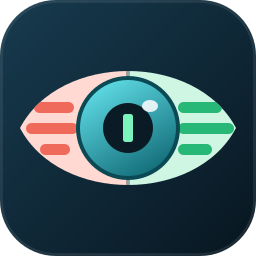
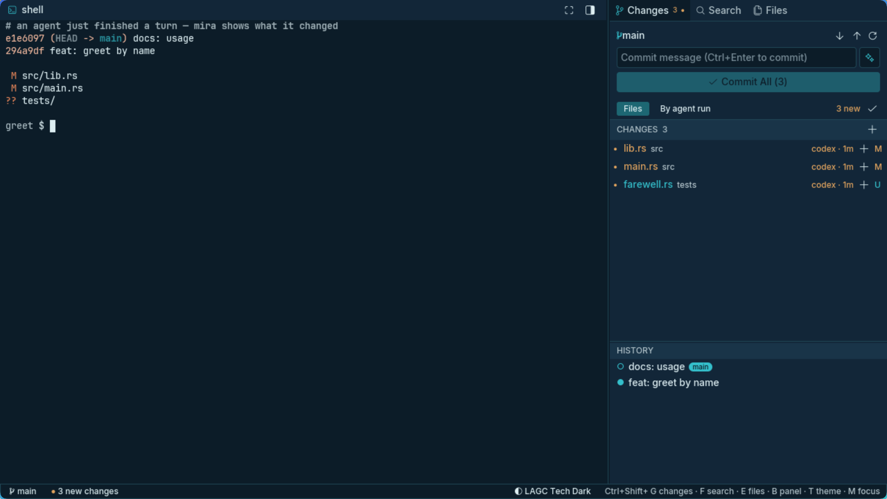

<p align="center">
  
</p>

<h1 align="center">mira</h1>

<p align="center">
  A light, terminal-first workspace for reviewing what your coding agents change.
  <br>
  <a href="https://github.com/IGUNUBLUE/mira/actions/workflows/ci.yml"></a>
  <a href="#license"></a>
  
</p>



*Mira* is Spanish for "look!". You talk to your agents (Codex, Claude Code, Kiro, …) in the
terminal; mira sits around that loop so you can **see what they did**, fix it, and commit it.

## Why

I moved most of my coding to agents that run in a terminal, and kept an editor open only to
review their work. The editor took more memory than the agents, and it still couldn't tell me
which agent changed which file. mira is the small tool I wanted instead: a native Rust app
with the terminal at the center and the review around it. [The longer story →](docs/why.md)

## Features

- **Terminal first.** The terminal runs [herdr](https://herdr.dev), so agents keep running in
  their workspaces and panes, even when mira closes. mira follows the herdr workspace you are in.
- **Changes, with authors.** Every changed file says which agent touched it and when. Review
  turn by turn, titled with your prompt; stage or revert a whole turn.
- **Diffs that talk back.** Side-by-side diffs. Click a line, write a comment, and it is typed
  into the pane of the agent that made the change.
- **Commit messages that stream.** Conventional Commits from your ChatGPT subscription, an
  OpenAI API key, or any local command (e.g. ollama).
- **The VS Code basics, without the weight.** Source control, search & replace, an explorer,
  a syntax-highlighted editor with undo and autosave, file icons, four themes.
- **Private by default.** No telemetry, no account needed, no network unless you ask for a
  commit message. [What leaves your machine →](docs/privacy.md)

## Install

```sh
curl -fsSL https://raw.githubusercontent.com/IGUNUBLUE/mira/main/install.sh | sh
```

This installs a release binary (or builds from source with cargo) into `~/.local`, with a
desktop entry and icon. Linux only for now (x86_64, aarch64). Uninstall with
`… | sh -s -- --uninstall`.

Works best with [herdr](https://herdr.dev) (agent tracking) and a
[Nerd Font](https://www.nerdfonts.com) (icons). It needs `git` and `curl`.

From source: `cargo install --git https://github.com/IGUNUBLUE/mira --locked`.

## Use

Open mira from your app launcher, or run `mira [folder]`. Ask an agent to do something in the
terminal; its changes show up on the right as it works. Key shortcuts: ``Ctrl+` `` terminal ·
`Ctrl+Shift+G` changes · `Ctrl+Shift+F` search · `Ctrl+Shift+E` files.

- [User guide](docs/guide.md): every panel, shortcuts, commit messages, herdr
- [Configuration](docs/configuration.md): `~/.config/mira/config`, environment, files
- [Privacy & network](docs/privacy.md)
- [Architecture](docs/architecture.md), for contributors · [Roadmap](docs/roadmap.md)

## Contributing

Issues and pull requests are welcome. Read [CONTRIBUTING.md](CONTRIBUTING.md) first; the
quality gate is `cargo fmt --check && cargo clippy --all-targets -- -D warnings && cargo test`.
Security issues: see [SECURITY.md](SECURITY.md).

## License

Dual-licensed under [MIT](LICENSE-MIT) or [Apache-2.0](LICENSE-APACHE), at your option.
