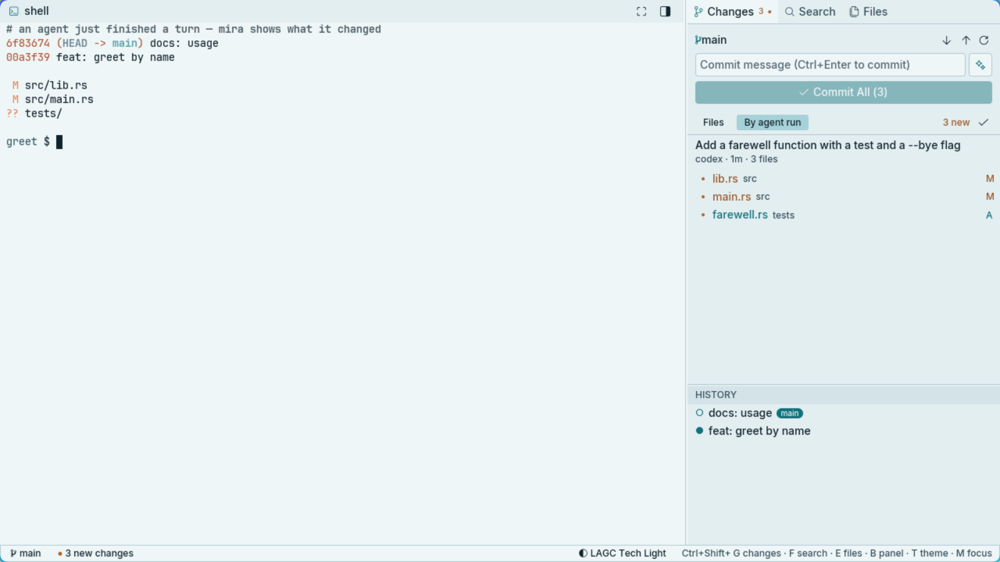

# User guide


mira has three parts: the **terminal** (center), the **inspector** on the right (Changes,
Search, Files) and the **document area**, which opens above the terminal when you open a
file or a diff. The status bar shows the branch, new changes and the theme.

## Folders and herdr workspaces

mira never asks for a folder; [herdr](https://herdr.dev) workspaces decide.

- `mira <folder>`, or `mira` run from a project directory, opens that folder and focuses its
  herdr workspace, creating one if needed.
- From the app launcher, mira opens the folder of herdr's focused workspace (or the last
  folder, until herdr answers).
- After that mira **follows herdr**: switch workspace in herdr and Changes, Files, Search and
  history switch with it. Open file tabs stay; diff tabs close.

Without herdr installed, mira runs your shell and shows a note in the terminal header. Set
`terminal = "shell"` to choose that on purpose (the note goes away).

### What herdr brings

mira doesn't detect agents itself: herdr does, and mira asks it. So any agent herdr recognizes
works in mira with no setup per agent: Claude Code, Codex, GitHub Copilot CLI, Cursor Agent,
OpenCode, Gemini CLI, Kiro, Amp, Droid, Qwen Code, Pi, Kimi, Kilo and the rest of
[herdr's list](https://herdr.dev/docs/agents/). Agents that report their own state to herdr
(Crush, Command Code, …) count too, and when herdr learns a new agent, mira follows.

For each of them you get:

- **Turns with authors.** Every working period becomes a turn in Changes, with a before/after
  diff, and each changed file says which agent touched it and when.
- **Status at a glance.** The terminal header lists the agents of this folder (working, done,
  needs you); "need you" in the status bar jumps to the one waiting for an answer.
- **Comments that reach the right agent.** A comment on a diff line is typed into the pane of
  the agent that made the change, even in another workspace.
- **Agents that outlive mira.** They run in herdr's server: close mira, open it again, and they
  are still there. Several agents can work side by side in herdr's workspaces and panes.

Two things depend on the agent rather than on herdr:

- The turn's title (your prompt) is read from the agent's own log, which mira knows for Codex,
  Kiro and Claude Code. Other agents' turns are titled with the agent's name.
- To get an agent's session back after the herdr *server* restarts (not mira), install its
  integration: `herdr integration install codex` (or `claude`, `copilot`, `opencode`, …; see
  [herdr's integrations](https://herdr.dev/docs/integrations/)).

An agent started through a wrapper (a sandbox, a VM) can hide from herdr; `HERDR_AGENT=claude
<wrapper> -- claude` tells herdr what it is. Without herdr, mira runs your shell: Changes,
diffs, commits and the rest work, without agents or turns.

## The terminal

The terminal runs herdr (`Ctrl+B` is herdr's prefix; `Ctrl+B ?` lists its keys). Agents keep
running in herdr when mira closes and are there again when it opens.

- The header lists the agents working in this folder with their status. Click one to jump
  to its pane, even in another workspace.
- "need you" in the status bar jumps to an agent that is waiting for you.
- Text is copied on selection; the mouse wheel, clicks and Alt+key reach herdr. Hold `Shift`
  to select with mira instead (`Ctrl+Shift+C` copies it, middle click pastes the selection).
  `Ctrl`+click opens a link (a `file://` link opens the file in mira).
- **Scrolling long output** (an agent's diff, a test run): drag the scrollbar at the right
  edge of the pane, or click its track to jump. From the keyboard, `Ctrl+B [` enters herdr's
  copy mode: `PageUp`/`PageDown`, `Ctrl+U`/`Ctrl+D`, `/` to search, `q` to leave.
  Programs that take the whole screen (Codex, vim) keep no history to scroll: Codex scrolls its
  own conversation (`Ctrl+T` shows the transcript).
- `Ctrl+Shift+V` (or `Shift+Insert`) pastes, bracketed when the program asks for it.
- With a plain shell (`terminal = "shell"`), `Shift+PageUp`/`PageDown` and the wheel scroll
  mira's own history.

### herdr settings

These go in `~/.config/herdr/config.toml`. They make herdr draw with mira's colors and stay
readable in light and dark palettes (herdr's `terminal` theme alone assumes a dark terminal):

```toml
[theme]
name = "terminal"
auto_switch = true      # mira tells herdr whether its palette is light or dark
dark_name = "terminal"
light_name = "terminal"

[theme.custom.light]
overlay0 = "darkgray"   # tabs, and the scrollbar track
overlay1 = "gray"       # named tabs, the right side of the tab bar, the scrollbar thumb
surface_dim = "white"   # text of the active tab
active_row_bg = "white"

[theme.custom.dark]
overlay1 = "blue"       # stands out from the track
surface_dim = "black"
active_row_bg = "darkgray"

[ui]
pane_scrollbars = true  # draggable scrollbars (herdr's default)

[ui.toast]
delivery = "system"     # notifications (mira doesn't send its own)
```

Then run `herdr server reload-config` (or choose `reload config` in herdr's menu). Restarting
mira only reloads herdr's client settings (the theme); pane scrollbars belong to the server.

## Changes: what the agents did



The Changes panel is your git working tree, and each file says **which agent changed it and
when** (`codex · 2m`; hover to see what you asked). While an agent works, mira takes snapshots
of the working tree before and after each of its turns. Snapshots use a temporary git index:
nothing is committed and your index is not touched. Switching to another folder doesn't lose a
turn's snapshots. A turn still running when mira last watched it (it showed another folder, or
was closed) ends when its folder is shown again; the agent's next turn starts a new one.

- Files changed since you last opened them get a dot; the tab and the status bar count them.
  `✓` marks them all as seen.
- **By agent run** lists each turn with its files, titled with your prompt (read from the
  agents' own logs; Codex, Kiro and Claude Code are supported). You can stage or revert a whole turn.
  Revert opens a confirmation explaining that later edits will be replaced.
- Turns that changed nothing don't show up. A quick follow-up during a turn stays part of it.

## Diffs and comments

Click a file to open a side-by-side diff with highlights inside changed lines. `‹ ›` steps
through the files of a turn. Very large files are shown as hunks, or not diffed when they
are over 8 MB.

Click a line, type a comment and send it. It is **typed into the pane of the agent that
changed that file** (through herdr, whichever pane has focus), prefixed with `path:line`,
ready for you to review and press Enter.

## Source control

Stage, unstage, commit, push and pull. History is under the Changes list; drag the divider to
resize it.

Actions show a small spinner at the button while they run and report their result in the status
bar. Manual refresh animates too; automatic refresh stays quiet. Stage, unstage, discard and
hunk actions cannot be clicked again until the current git action finishes.

- **Publishing a branch.** Push opens **Publish branch** when the local branch has no tracking
  branch. Choose the remote and explicitly publish; mira sets tracking only after success.
  Existing tracked branches use Git's configured push destination. Pull requires a tracking
  branch and always uses `--ff-only`.
- **Git failures stay visible.** Foreground failures open a dialog with the repository, branch,
  destination, explanation and Git output. Copy the details, retry, or copy the command for a
  shell to handle authentication, host verification or repository setup. The command is never
  typed into an agent or executed automatically. Timeout means the remote result is unknown,
  not that the push definitely failed to reach the server.
- **Connections.** With Git's default OpenSSH transport, mira uses batch mode and an eight-second
  connection/handshake timeout per address, letting SSH try its next address when IPv6 is
  unavailable. Configured SSH commands/variants and environment overrides are preserved.
  Connection failures also offer **Retry via IPv4**, through Git's own `--ipv4` option. No global
  Git or SSH configuration is changed and remote writes are never automatically retried.
  A retry is rejected if the branch, commit or routing configuration changed in the meantime.
- **Row buttons** appear on hover (or on the open file), as in VSCodium: open the file, discard
  its changes, stage or unstage it. Section headers have the same for every file, plus
  **Review** (⇄), which opens the first diff; `‹ ›` in the diff then walks through the section.
- **Discard is undoable.** mira snapshots the working tree first (the same snapshots it takes
  around agent turns). Discarding a file, a hunk or all changes opens a confirmation dialog
  listing the affected files and warning that new (untracked) files will be deleted. The status
  bar then offers **Undo**. Restoring the snapshot also asks, because it replaces later edits.
- **One change at a time.** In a diff from Changes, each of git's hunks has a bar with its
  `@@` line and **Stage** / **Discard** (unstaged diff) or **Unstage** (staged diff), like
  VSCodium's per-change actions. Discarding a hunk is undoable too.
- The "N new" count only counts files that are still in Changes and you haven't opened since an
  agent changed them.

- With nothing staged, **Commit All** stages every listed change of this folder (the button
  shows how many; untracked files are counted in its tooltip). If the commit is rejected (a
  hook, say), what it staged is unstaged again.
- Merge conflicts get their own section and block the commit until you fix and stage them.
- A folder that isn't a repository offers **Initialize repository**.
- git runs as your own `git`, so hooks, signing and credential helpers behave as in your
  terminal. Errors show the line that matters, with the full output in a tooltip.

Destructive actions use a modal with **Cancel** selected initially. **Escape** or a click outside
cancels; **Tab** selects the other button and **Enter** activates the selected action. Reverting
an agent run warns that later edits to its files will also be replaced. A folder switch cancels
pending confirmations; a changed target or file list requires reviewing the action again.

## Commit messages

Click ✦ next to the commit box. mira writes a [Conventional Commits](https://www.conventionalcommits.org)
message from the staged diff (or from all changes, when nothing is staged). Lockfiles are left
out, so are the contents of files with over 2000 changed lines (they're still listed), and the
diff is capped at 12k characters. The text streams into the box; click ✦ again to
stop and get back what you had. `Ctrl+Z` after it finishes also brings that back.

Pick a provider with `commit_provider` in the [config](configuration.md):

| Provider | What it uses |
|---|---|
| `chatgpt` | Your ChatGPT subscription. The first time, a dialog explains the sign-in and asks before opening your browser (the same flow as `codex login`); if the browser doesn't open, copy the link from the dialog. The account icon next to Pull/Push asks before signing out. |
| `openai` | An API key from `OPENAI_API_KEY` or `~/.config/mira/openai_key` (must be `chmod 600`). |
| `command` | `commit_command`: any command that reads the prompt on stdin and prints the message, for example a local model with ollama. Its output streams too. |
| `auto` (default) | The ChatGPT session if you are signed in, else an API key, else `commit_command`, else asks you to sign in. |

The ChatGPT subscription endpoint is undocumented and may change; an API key or a local
command are the stable options. See [privacy](privacy.md) for exactly what is sent.

## Editor, search and files

- **Editor**: syntax highlighting and line numbers (the cursor's line is highlighted), `Ctrl+S`
  to save, `Ctrl+W` or middle-click to close a tab. Long lines don't wrap; the view follows the
  cursor sideways.
  Tabs without unsaved edits reload when an agent changes the file.
- **Images** (PNG, JPEG, GIF, WebP, BMP, ICO) open in an image tab with their size: scroll to
  zoom, drag to pan. An SVG opens as text; **Preview** shows what it draws. Both reload when
  the file changes.
- **Undo / redo**: `Ctrl+Z`, `Ctrl+Shift+Z` or `Ctrl+Y`, in the editor and the commit box, one
  step per word as in VS Code. A reload caused by an agent is undoable too.
- **Autosave** is on: files save 1 s after you stop typing, and when you leave the window,
  close a tab or quit. It never overwrites a file that changed on disk under your edits (for
  example, an agent wrote it): it pauses for that tab and tells you. `Ctrl+S` opens a dialog
  before replacing those disk contents. Closing a tab or the window with unsaved edits also
  asks before losing them.
- **Search & replace** respects `.gitignore`, with match case, whole word and regex options.
  Replace all works line by line, exactly like the results show, and asks for confirmation before rewriting the files on disk.
- **Files** shows the tree with git status colors; ignored files are dimmed. Right-click a file
  or folder (or the empty space, for the folder itself) for **New File / New Folder**,
  **Rename** (typed in place: `Enter` saves, `Escape` cancels), **Delete** (to the desktop's
  trash after confirmation, with **Undo** in the status bar), **Copy Path**, **Copy Relative Path** and **Send Path
  to Agent**.

## Look

Four palettes, LAGC Tech and Calm, each light and dark. The default, `auto`, follows the
active [HyDE](https://github.com/HyDE-Project/HyDE) theme when HyDE is installed, else LAGC
Tech Light. `Ctrl+Shift+T` or the status bar cycles through them.

The gear at the right of the status bar opens **Settings** (also `Ctrl+,`), the list of
**Keyboard Shortcuts**, **Check for Updates** (the releases page, in your browser) and **About**
(version, herdr's version, links and a "Copy info" for bug reports). On desktops that draw no
title bar (Hyprland and other tiling compositors), set *Window controls* to `on` for mira's own
close, minimize and maximize buttons. Typed settings save on `Enter` or when the dialog closes;
one that isn't valid keeps the dialog open with the reason (closing again drops it).

Icons come from any installed [Nerd Font](https://www.nerdfonts.com); without one mira uses
plain symbols. Fonts default to Inter and JetBrains Mono (medium weight); see
[configuration](configuration.md) to change them. Panel sizes are remembered.

## Shortcuts

| Keys | Action |
|---|---|
| ``Ctrl+` `` | Focus the terminal |
| `Ctrl+B` … | herdr's prefix |
| `Ctrl+Shift+G` / `F` / `E` | Show Changes (focuses the commit message) / Search (focuses the query) / Files |
| `Ctrl+Shift+B` | Show or hide the inspector |
| `Ctrl+Shift+M` | Focus mode |
| `Ctrl+Shift+T` | Next theme |
| `Ctrl+,` | Settings |
| `Ctrl+Shift+V` | Paste into the terminal |
| `Ctrl+Shift+P`, `Ctrl+P` | Quick open: go to a file of the folder by name (fuzzy; `:` + a number goes to a line) |
| `Ctrl+F` | Find in the open file (`Enter` / `Shift+Enter` or `F3` / `Shift+F3`: next / previous) |
| `Ctrl+G` | Go to line in the open file |
| `Ctrl+S` / `Ctrl+W` | Save / close tab |
| `Ctrl+Z` / `Ctrl+Shift+Z`, `Ctrl+Y` | Undo / redo |
| `Ctrl+Enter` | Commit (in the commit box) |
| `Escape` | Cancel, one at a time: quick open, the sign-in dialog, the find bar, a pending confirmation, the diff's selected line, its comment, the status message |

`Ctrl+Shift+…` and ``Ctrl+` `` work while the terminal has focus; plain `Ctrl+P`, `Ctrl+F` and
`Ctrl+G` stay with the shell there and act in mira only outside the terminal. `Escape` stays with the
terminal and with focused inputs (except quick open and the find bar, which it closes); mira only
acts on it when nothing else does.
